

 

### A research prototype exploring how physiology changes over time

VITALIS explores an **adaptive physiological digital twin** alongside separate retrospective machine-learning experiments. It studies personal baselines, deviations, persistence, temporal features, and benchmark-label forecasting.

<table>
  <tr>
    <td align="center"></td>
    <td align="center"></td>
  </tr>
  <tr>
    <td align="center"></td>
    <td align="center"></td>
  </tr>
</table>

Choose a path into the VITALIS research prototype ↓

---

## 💜 Meet VITALIS

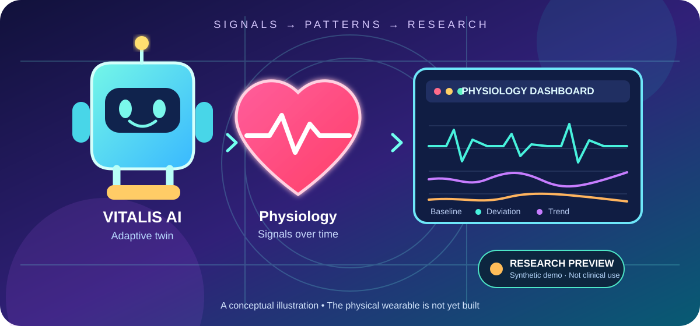

The robot, heart and dashboard are explanatory artwork—not a completed medical device or a validated clinical system.

## 🌊 From signal to research insight

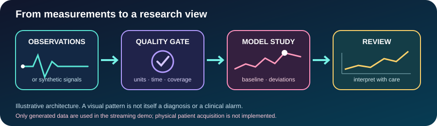

The central idea is simple: **a measurement is more meaningful when we understand its history, data quality, and context.** VITALIS experiments with mathematics that represents deviations from a changing personal reference, while keeping retrospective prediction models as a separate research track.

## 🧭 What exists today—and what does not

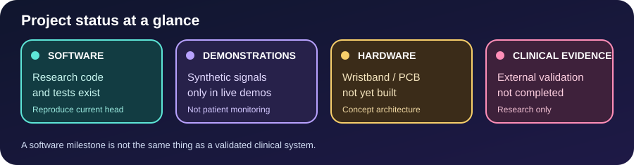

| Area | Current state |
|---|---|
| Retrospective cohort workflow | Research scripts and documented benchmark experiments are present; follow the runbook to reproduce them. |
| Adaptive physiological twin | An initial software component calculates unitless deviation and trajectory heuristics. |
| Patient-baseline features | An experimental causal feature generator supports retrospective model comparison. |
| Supervised horizon experiments | Separate retrospective experiments target future entry into the Challenge label window at 1, 3, and 6 hourly rows. |
| Streaming demo | Synthetic/generated values only; not real patient monitoring. |
| ESP32 USB example | Synthetic test values only; no sensor drivers or patient connection. |
| Wristband, PCB and physical sensor integration | Proposed architecture—not built or validated. |
| Independent external or prospective clinical validation | Not completed. |

> [!IMPORTANT]
> **Research prototype only.** VITALIS is not a medical device or a clinically validated decision-support system. Do not use its outputs for diagnosis, triage, monitoring, treatment, or any patient-care decision.

---

# 🧠 AI Mathematics & Algorithms Lab

This is the mathematical heart of VITALIS. The diagrams below are original, topic-specific visual explanations; the full derivations, assumptions, implementation boundaries, and source links are in the [complete AI Mathematics & Algorithms guide](docs/AI_MATHEMATICS_AND_ALGORITHMS.md).

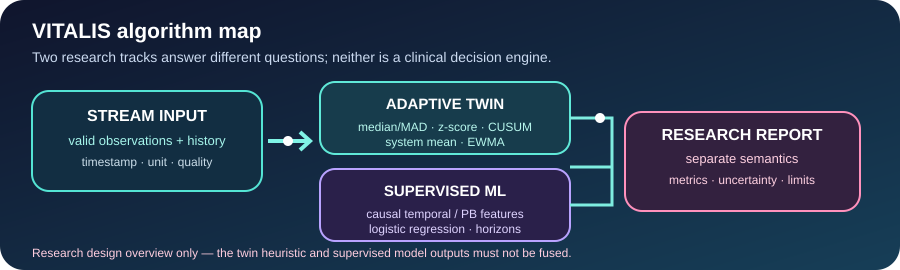

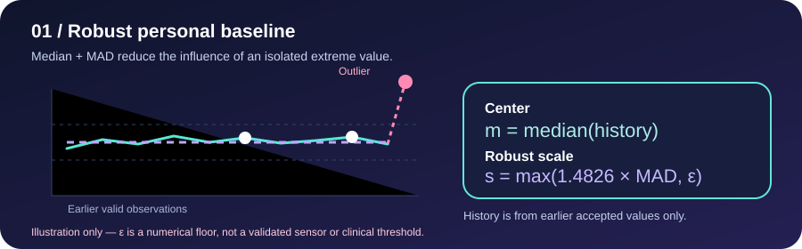

### 1. Robust baseline — median and MAD

For channel \(j\) at time \(t\), the twin uses earlier accepted observations \(H_{j,t}\):

$$
m_{j,t}=\mathrm{median}(H_{j,t}),\qquad s_{j,t}=\max\left(1.4826\,\mathrm{MAD}(H_{j,t}),\epsilon_j\right)
$$

The median is less sensitive than the mean to a single extreme observation. The robust scale floor \(\epsilon_j\) avoids a vanishing denominator; it is a numerical engineering parameter, not a validated sensor-noise or clinical threshold. The current value is scored **before** it can update the history.

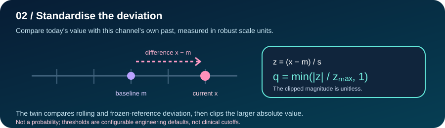

### 2. Standardized deviation — how far from the reference?

$$
z_{j,t}=\frac{x_{j,t}-m_{j,t}}{s_{j,t}},\qquad z^0_{j,t}=\frac{x_{j,t}-m^0_j}{s^0_j}
$$

VITALIS compares the current value with both a rolling baseline and a frozen initial reference. It clips the larger absolute standardized deviation to a bounded, unitless channel score \(q_{j,t}\in[0,1]\). This score is **not** a sepsis probability.

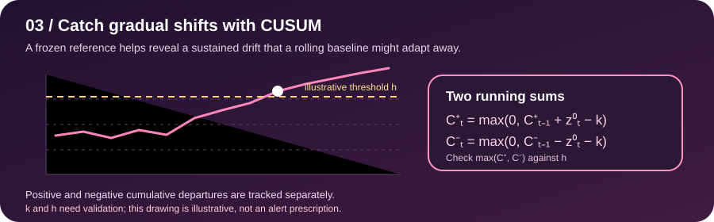

### 3. CUSUM — help reveal gradual drift

$$
C^+_{j,t}=\max\left(0,C^+_{j,t-1}+z^0_{j,t}-k\right)
$$

$$
C^-_{j,t}=\max\left(0,C^-_{j,t-1}-z^0_{j,t}-k\right)
$$

The twin tracks positive and negative departures from the frozen reference. A configured shift condition is reached when \(\max(C^+_{j,t},C^-_{j,t})\ge h\). Parameters \(k\) and \(h\) need validation and are **not** clinical alarm cutoffs.

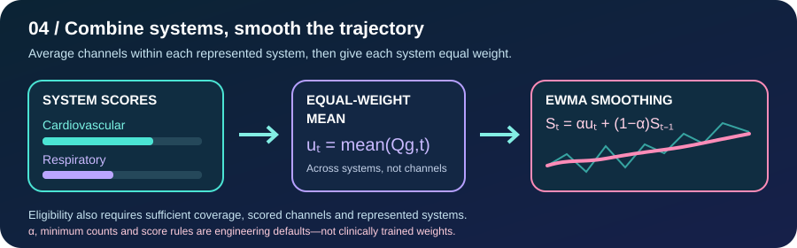

### 4. Multiple systems — aggregate without letting one group dominate

Channels are averaged within each represented physiological system; the available systems then receive equal weight. An exponentially weighted moving average (EWMA) smooths the result:

$$
u_t=\frac{1}{|G_t|}\sum_{g\in G_t}Q_{g,t},\qquad S_t=\alpha u_t+(1-\alpha)S_{t-1}
$$

The twin also tracks data coverage, persistent channel deviations, and cross-system concordance. It withholds an eligible summary unless minimum data coverage, scored-channel count, and represented-system count are met. Weights and thresholds are configurable engineering defaults, not learned medical weights.

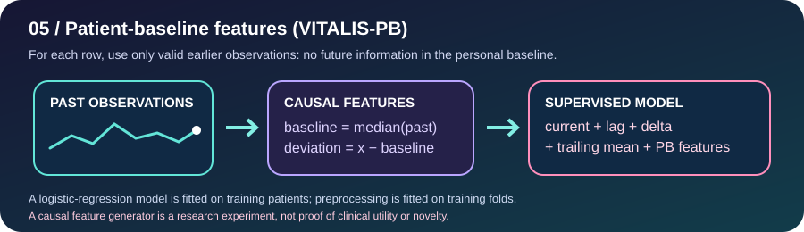

### 5. VITALIS-PB — patient-specific features for retrospective ML

A separate feature generator uses valid observations strictly before row \(t\) to calculate a personal baseline, raw deviation, and robust normalized deviation:

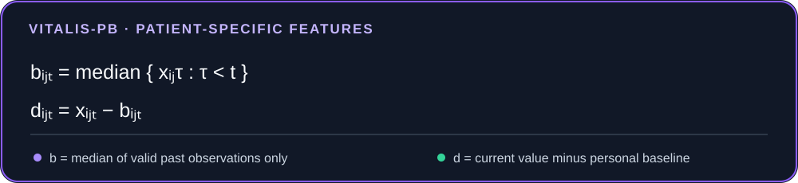

The experimental model can also use current values, lags, one-step deltas, and trailing six-row means. The supervised logistic-regression workflow fits preprocessing only on training folds and keeps patient groups separate across train/validation/test. This is a research feature experiment—not proof of clinical utility, novelty, or patentability.

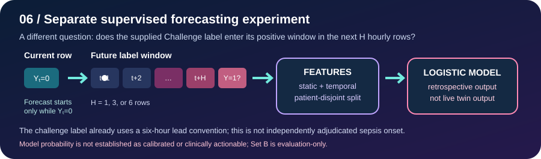

### 6. Supervised forecasting — separate 1-, 3-, and 6-hour experiments

For current Challenge label \(Y_{i,t}=0\), the experimental target asks whether any label becomes positive in the next \(H\) hourly rows:

$$
Y^{(H)}_{i,t}=\mathbf{1}\left(Y_{i,t}=0\ \text{and}\ \max_{1\le r\le H}Y_{i,t+r}=1\right)
$$

The official Challenge label already uses a six-hour lead convention. Therefore, these experiments forecast **entry into the Challenge-positive label window**, not independently observed biological sepsis onset. Set B is a held-out partition within the same challenge—not an independent external clinical cohort.

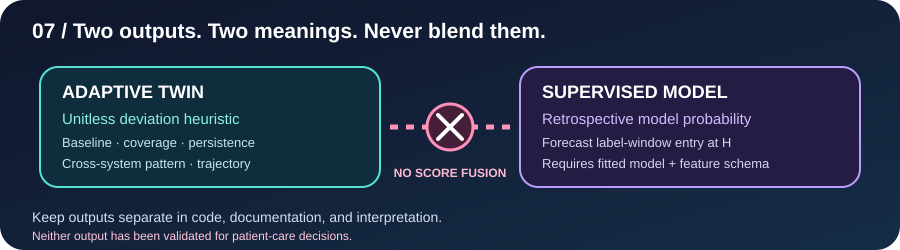

### 7. Two outputs must stay separate

- **Adaptive twin:** unitless deviation heuristic, data coverage, persistence, cross-system pattern, and trajectory summary.
- **Supervised model:** retrospective model output for a specifically defined benchmark target, when a fitted predictor and matching feature schema are available.

The two are **not** added, averaged, or fused. The twin score is not a probability. If no frozen supervised predictor is supplied, the research interface marks the supervised output unavailable/null rather than inventing a zero.

<b>🔎 Open the full equations, assumptions, and implementation boundaries</b>

The complete guide covers the input contract, robust scale definition, frozen and rolling baselines, CUSUM update rules, system aggregation, EWMA, persistent-deviation states, causal patient-baseline features, future-label target semantics, separate output contract, and validation plan.

➡️ **[Open the full AI Mathematics & Algorithms Lab](docs/AI_MATHEMATICS_AND_ALGORITHMS.md)**

Related source and specifications:
- [Adaptive twin implementation & validation contract](docs/ADAPTIVE_TWIN_IMPLEMENTATION.md)
- [VITALIS-PB algorithm](docs/VITALIS_PB_ALGORITHM.md)
- [Future-label forecasting protocol](docs/HORIZON_FORECASTING.md)
- [Streaming/supervised interface contract](docs/STREAMING_SUPERVISED_INTERFACE.md)

---

## 🧪 Research workflow: make results reproducible

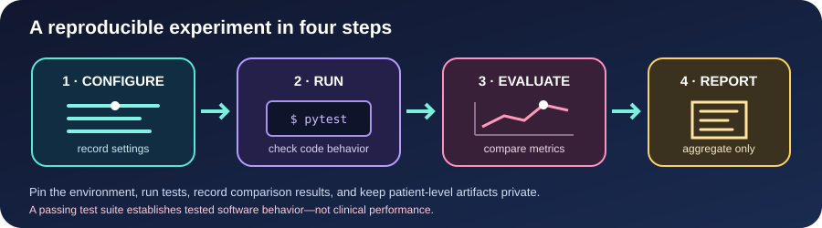

VITALIS is organised around auditable experiments, not just a live-looking dashboard. Pin the environment, run tests, compare models on the defined split, and store aggregate results with provenance. A passing test suite shows expected software behavior; it does not establish clinical performance.

### Quick start

<pre><code>python -m venv .venv
# Activate the virtual environment, then:
pip install -e ".[dev]"
pytest</code></pre>

Keep authorised PhysioNet/CinC Challenge 2019 data outside Git and comply with dataset terms. To inventory a local per-patient PSV folder:

<pre><code>python scripts/build_cohort.py /path/to/psv_files --output outputs/cohort_inventory.json</code></pre>

Run synthetic demonstrations:

<pre><code>python scripts/demo_adaptive_twin.py
python scripts/demo_integrated_inference.py</code></pre>

For the aggregate dashboard, install the optional extra and run:

<pre><code>pip install -e ".[dashboard]"
streamlit run dashboard/app.py</code></pre>

For the synthetic adaptive-twin sandbox:

<pre><code>streamlit run dashboard/twin_demo.py</code></pre>

All streaming demos use generated signals and do not constitute clinical prediction or patient monitoring.

## 📊 Research reports and provenance

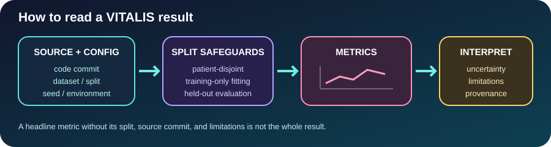

| Resource | What it contains |
|---|---|
| [Project status](docs/PROJECT_STATUS.md) | Plain-language progress, limitations, and remaining gates. |
| [Release readiness audit](docs/RELEASE_READINESS_AUDIT.md) | Remaining software and validation requirements. |
| [Reproducible workflow](docs/REPRODUCIBLE_WORKFLOW.md) | Commands and steps for a documented run. |
| [Full-cohort cross-cohort report](docs/FULL_COHORT_CROSS_COHORT_RESULTS.md) | Benchmark Set A-to-Set B comparison and limitations. |
| [Full-cohort horizon report](docs/FULL_COHORT_HORIZON_CROSS_COHORT_RESULTS.md) | Retrospective 1/3/6-hour label-window experiments. |
| [Calibration and operating-point protocol](docs/HORIZON_CALIBRATION_OPERATING_POINT_PROTOCOL.md) | Development-only calibration/threshold-selection rules and evaluation boundary. |
| [Independent evaluation protocol](docs/INDEPENDENT_EVALUATION_PROTOCOL.md) | Requirements for a genuinely new cohort and independent review. |
| [Model card](docs/MODEL_CARD.md) | Intended use, evaluation, limitations, and governance. |
| [Next steps](docs/NEXT_STEPS.md) | Research roadmap and unresolved work. |

Historical reports are evidence tied to specific code and data provenance. They are not automatically reproduced by the current repository head. Do not describe Set B as independent external clinical validation, and do not interpret benchmark label-window metrics as validated biological sepsis-onset forecasts.

## 🔐 Data safety is part of the design

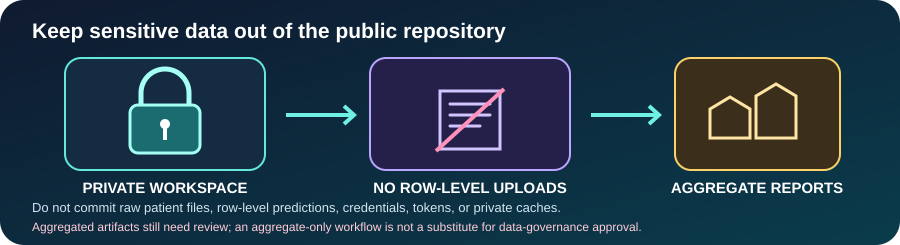

**Never commit** raw patient files, derived patient-level tables, individual predictions, credentials, tokens, or private caches. Keep sensitive inputs and row-level outputs in an approved private workspace. Aggregate-only outputs still require review; data hygiene does not replace a governance or privacy audit.

## 🔌 Hardware pathway: future integration, not a finished device

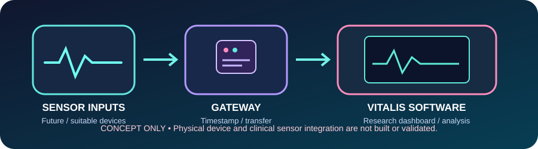

The hardware blueprint describes a proposed route from suitable sensor interfaces through a timestamped gateway to VITALIS software. The physical wristband, custom PCB, validated sensor acquisition, complete synchronisation, and clinical safety testing are **not built or validated**.

- [Hardware integration blueprint](docs/HARDWARE_INTEGRATION_BLUEPRINT.md)
- [Synthetic ESP32 gateway instructions](docs/ESP32_SYNTHETIC_GATEWAY.md)
- [Synthetic gateway test record](docs/GATE3_SOFTWARE_BENCH_RESULTS_2026-10-18.md)
- [Physical-bench record template](docs/GATE3_PHYSICAL_BENCH_RECORD_TEMPLATE.md)

Do not connect a person to the synthetic ESP32 bench. It transmits generated toy values and is not a physiological sensor acquisition system.

## 🗂️ Repository map

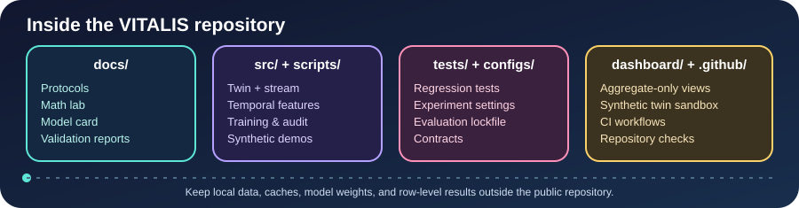

<pre><code>docs/                 Research protocols, math lab, model card, validation
docs/assets/          Original explanatory SVG illustrations and animations
src/vitalis/          Reusable time-series features, adaptive twin, stream contracts
scripts/              Cohort audit, training, comparison, synthetic demos
configs/              Experiment and independent-evaluation templates
tests/                Unit, regression, and interface-contract tests
dashboard/            Aggregate report dashboard and synthetic twin sandbox
.github/workflows/    Automated checks</code></pre>

## ✅ What must happen before any clinical translation?

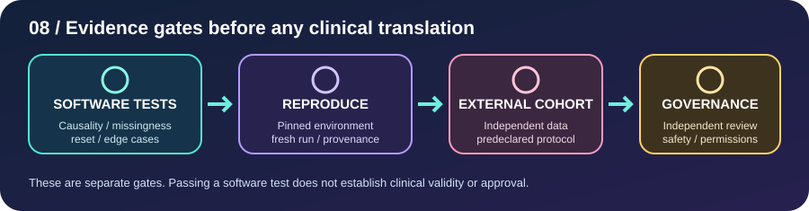

Software correctness, exact-source reproducibility, independent statistical/clinical review, authorized independent-cohort evaluation, prospective evaluation, suitable sensor testing, and regulatory/governance approvals are separate gates. No external or prospective clinical validation has been completed. The project does not claim novelty or patentability.

---

**Built with curiosity. Guided by physiology. Grounded in reproducibility.**

[📚 Project status](docs/PROJECT_STATUS.md) · [🧠 AI Mathematics Lab](docs/AI_MATHEMATICS_AND_ALGORITHMS.md) · [🧪 Release readiness](docs/RELEASE_READINESS_AUDIT.md)

VITALIS remains research-only—not a medical device, diagnosis system, or clinical decision-support tool.

 

### 👨‍💻 Created by the researcher

**© 2026 Abhijith Premjithlal.**  
VITALIS is an ongoing research prototype. Please credit the author and link to this repository when referencing or sharing this work. This notice does not replace the repository's applicable open-source licence.

Research, ideas, and project progress — follow along on Instagram.

