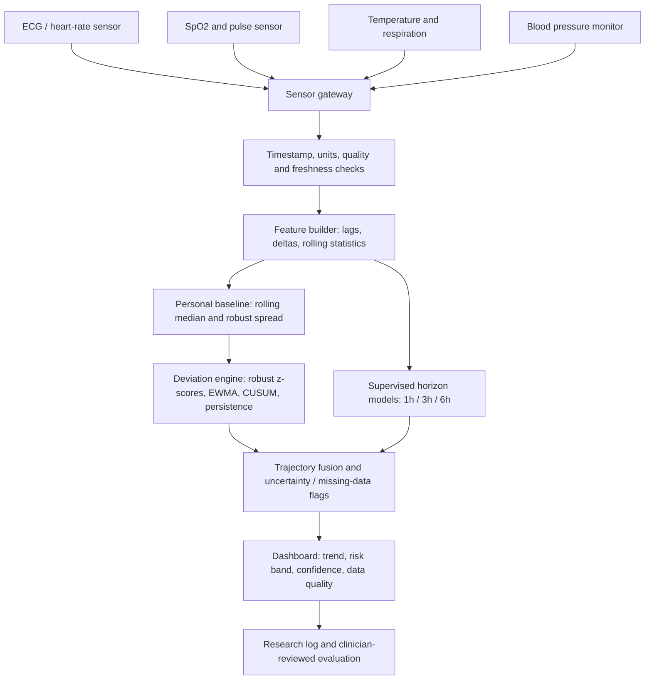

# VITALIS hardware integration blueprint

**Status:** proposed engineering architecture for a research prototype. It is not a validated medical device, treatment recommendation system, or a substitute for clinical monitoring.

## 1. The plain-language idea

Think of VITALIS as a personal weather forecast for physiology. It first learns what is usual for one person from earlier measurements. It then compares new measurements with that personal reference, looks for persistent or multi-signal changes, and estimates retrospective risk over several future horizons. It should report a trend and uncertainty—not simply declare “sepsis”.

The model does not diagnose sepsis. The current dataset target is entry into the PhysioNet/CinC Challenge 2019 `SepsisLabel` positive window, which is not the same as independently confirmed biological onset.

## 2. System architecture

The adaptive deviation engine and supervised prediction model are separate components. Their outputs may be compared and fused only after the fusion rule has been defined and evaluated on development data. The diagram describes a target integration architecture, not a claim that every sensor or pathway is already implemented.

## 3. Recommended staged hardware

Do not start by building a custom PCB. Start with a safe bench prototype and simulated/replay data, then add one sensor at a time.

| Part | Purpose | Prototype guidance |
|---|---|---|
| Raspberry Pi 5 or similar Linux SBC | Runs Python inference, gateway and local dashboard | Main compute unit for first prototype |
| microSD or SSD, power supply, enclosure, heat management | Reliable local operation | Use manufacturer-rated supply and storage |
| USB / BLE / serial interface | Receives data from supported sensors | Prefer documented interfaces and timestamped records |
| Pulse oximeter / heart-rate sensor with documented data access | HR and SpO2 stream | Verify signal-quality flags and update rate |
| Digital temperature sensor or medical monitor with data export | Temperature stream | Confirm calibration and units |
| Respiration source | Respiratory rate | Prefer a validated monitor/data feed; do not infer a clinical value from an unvalidated DIY sensor |
| Blood-pressure monitor with documented export | SBP/DBP/MAP when available | Cuff readings are intermittent, not continuous |
| Optional ECG front end | ECG waveform / derived HRV research | Use an isolated, medically appropriate module; never connect DIY circuitry directly to a person without qualified safety review |
| Optional ESP32-class microcontroller | Sensor acquisition / timestamp relay | Keep the safety-critical inference and storage logic on the gateway initially |
| Network only if needed | Updates / remote dashboard | Local-first design; encrypt transfers and authenticate devices |

**Do not buy all components before validating the interface requirements.** For each sensor, record exact model, protocol, output fields, sampling frequency, units, timestamps, quality flags, power needs and data-export terms. Consumer wearable APIs may not provide raw signals or sufficiently frequent updates.

## 4. Software-to-hardware boundary

Keep the algorithm independent of hardware. A sensor adapter should convert each vendor-specific message into a canonical observation:

- `patient_session_id` — pseudonymous session token, never a name or medical record number in research logs.
- `timestamp` — timezone-aware UTC time, plus monotonic receive time where supported.
- `signal` — e.g. HR, SpO2, Temp, Resp, SBP, DBP or MAP.
- `value` and `unit` — explicit numeric value and unit.
- `quality` — device-provided quality state where available.
- `source` and `sequence_number` — sensor identity and ordering.
- `missing_reason` — disconnected, invalid, stale, rejected or not measured.

Reject unknown units, impossible values, duplicate/out-of-order timestamps and stale samples. Never silently convert missing values to normal values. Store raw data only where consent, security and research governance permit; default to minimal local storage and aggregate logs.

## 5. Inference cycle

1. Acquire and timestamp measurements.
2. Validate units, range, quality and freshness.
3. Build causal features from prior observations; preserve strict patient/session boundaries.
4. Update the personal reference only with accepted observations. Use a warm-up state until enough history exists.
5. Calculate robust deviation features (for example, median/MAD-based deviation), persistence, EWMA and CUSUM states.
6. Run the frozen supervised models for 1-, 3- and 6-hour retrospective targets, if the input schema and model artifact versions match.
7. Combine outputs only with a predeclared, evaluated rule. Return risk estimates, trend, missing-data status and uncertainty—not an unqualified diagnosis.
8. Record software version, model version, input freshness and aggregate operational events without leaking patient identifiers.

A sudden severe deviation, missing sensors or an out-of-distribution input should produce a transparent “data insufficient / research alert” state, not a fabricated probability.

## 6. Software modules and hardware interfaces

| Module | Responsibility | Hardware boundary |
|---|---|---|
| Sensor adapters | BLE / USB / serial / file input | Device-specific drivers only |
| Canonical stream validator | Units, time, quality, freshness, ordering | Hardware-independent |
| Feature pipeline | Lags, deltas, trailing means, missingness | Hardware-independent |
| Personal physiology state | Prior-only robust baseline, deviation, EWMA/CUSUM and persistence | Stateful per session; reset policy required |
| Forecast model | Frozen model artifact and 1/3/6-hour outputs | CPU inference first; no accelerator required |
| Alert policy | Research thresholds, persistence and refractory rules | Must be developed on Set A and frozen before Set B |
| Local dashboard | Trend, risk band, confidence, sensor health and explanation | Local browser/display |
| Audit and privacy | Versioning, access control, retention, aggregate logs | Encrypted local storage |

## 7. Required model outputs

The user interface should distinguish these outputs rather than collapse everything into a single unexplained score:

- **Data quality:** good, degraded, stale or insufficient.
- **Personal deviation:** which channels are different from the individual's recent reference, and by how much.
- **Trajectory:** stable, early deviation, persistent/multisystem deviation, or worsening trajectory—only after the state logic is tested.
- **Forecasts:** model-estimated probability for the 1-, 3- and 6-hour Challenge-label targets, with calibration and uncertainty caveats.
- **Operational status:** sensor disconnected, warm-up incomplete, model unavailable, or inference stale.

The terms “low/moderate/high risk” must not be assigned clinical meaning until a threshold policy is predeclared, calibrated and independently evaluated. A risk estimate is not a diagnosis.

## 8. Validation gates before connecting to people

- **Gate A — replay:** deterministic unit tests using synthetic streams, missing values, out-of-order data, sensor dropouts and unit errors.
- **Gate B — recorded data:** replay authorized retrospective data through the exact stream interface and compare results with the offline evaluator.
- **Gate C — bench integration:** connect sensors to a dummy/test fixture; verify timestamps, packet loss, reconnect behavior, latency, power and thermal behavior.
- **Gate D — silent observational study:** only after institutional/ethics approval, device safety review, privacy review, and a prospective protocol. Do not send alerts to guide care.
- **Gate E — clinical validation:** independent, appropriately powered prospective evaluation and regulatory review before any patient-care use.

Set B is another Challenge 2019 cohort, not independent prospective clinical validation. It must remain evaluation-only; do not tune features, calibration, thresholds or fusion rules on it.

## 9. Minimum acceptance tests

- Every input has an explicit unit, timestamp and source.
- Stale, invalid, out-of-order and missing readings are surfaced correctly.
- No patient/session state crosses a boundary.
- Personal reference updates use prior accepted observations only.
- Restart/reconnect behavior is deterministic and documented.
- Model/schema/version mismatch fails closed.
- Missing channels never become silent normal values.
- Output includes model version, horizon, freshness and quality flags.
- End-to-end replay matches the offline implementation within predeclared tolerances.
- No patient identifiers or row-level predictions are committed to GitHub.
- All output thresholds and alert behavior are research-only until separately validated.

## 10. Current state versus planned work

**Already represented in software:** retrospective cohort evaluation, static and temporal logistic-regression baselines, 1/3/6-hour target construction, causal temporal features, patient-relative robust deviation features, evaluation metrics, a research dashboard, and an experimental physiology-deviation design.

**Still required before a real device:** sensor-specific adapters, canonical streaming contract and integration tests against actual devices, restart-safe state management, versioned deployment packaging, device QA, latency/power measurements, cybersecurity/privacy review, independent validation and regulatory assessment.

The current personal-feature ablation is not by itself a complete real-time digital twin. A complete twin also needs explicit state initialization, safe update/freeze rules, drift handling, uncertainty, sensor-quality gating, persistence logic and replay equivalence tests.

## 11. Safety and scope

VITALIS is a research prototype. Do not use it to diagnose, triage, treat, or delay escalation of care. Do not connect unreviewed DIY electronics to a patient. All human-data collection and prospective testing require appropriate consent, ethics/governance, security, electrical safety and clinical oversight.
