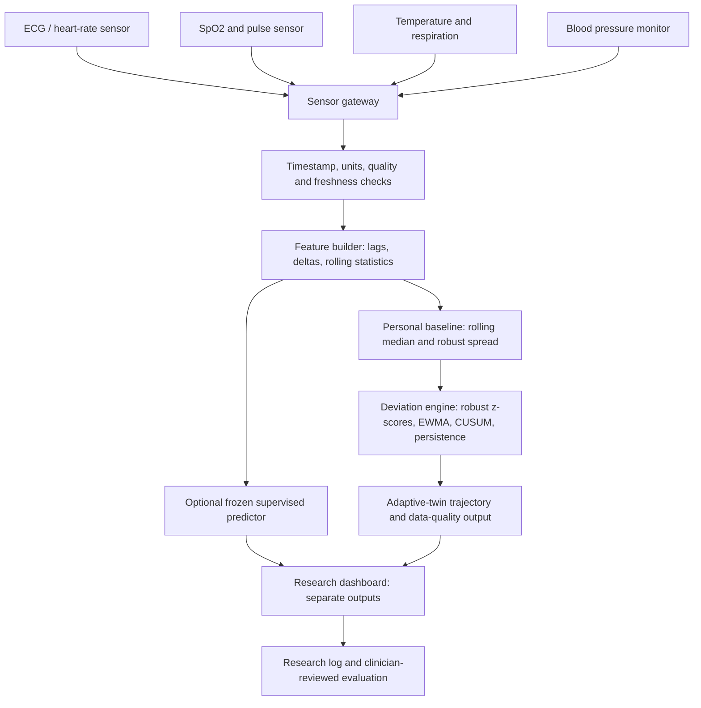

# VITALIS hardware integration blueprint

**Status:** proposed engineering architecture for a research prototype. It is not a validated medical device, treatment recommendation system, or a substitute for clinical monitoring.

**Implementation status as of 17 October 2026:** the software has a timestamped, unit-checked stream adapter and a synthetic adaptive-twin demo, but no device-specific sensor adapters, no integrated hardware, and no frozen supervised model artifact wired into the demo. This blueprint is a bench-only design proposal, not a frozen bill of materials (BOM), approved safety design, or permission to connect the system to a person. Real sensor parts remain provisional until the interface and verification plan are reviewed.

## 1. The plain-language idea

Think of VITALIS as a research tool for exploring individual physiological deviation. The adaptive twin compares new values with a reference learned from prior accepted observations and summarizes persistent or multi-system changes. A separate supervised model can estimate entry into a benchmark label window only when a compatible frozen predictor is explicitly supplied. The default integrated demo has no such predictor, so supervised probabilities are unavailable. The twin reports a unitless heuristic, not a clinical risk probability or diagnosis.

The model does not diagnose sepsis. The current dataset target is entry into the PhysioNet/CinC Challenge 2019 `SepsisLabel` positive window, which is not the same as independently confirmed biological onset.

## 2. System architecture

The adaptive deviation engine and supervised prediction model are separate components. Their outputs may be compared and fused only after the fusion rule has been defined and evaluated on development data. The diagram describes a target integration architecture, not a claim that every sensor or pathway is already implemented.

## 3. Recommended staged hardware

Do not start by building a custom PCB. Start with a safe bench prototype and simulated/replay data, then add one sensor at a time.

| Part | Purpose | Prototype guidance |
|---|---|---|
| Raspberry Pi 5 or similar Linux SBC | Runs Python inference, gateway and local dashboard | Main compute unit for first prototype |
| microSD or SSD, power supply, enclosure, heat management | Reliable local operation | Use manufacturer-rated supply and storage |
| USB / BLE / serial interface | Receives data from supported sensors | Prefer documented interfaces and timestamped records |
| Pulse oximeter / heart-rate sensor with documented data access | HR and SpO2 stream | Verify signal-quality flags and update rate |
| Digital temperature sensor or medical monitor with data export | Temperature stream | Confirm calibration and units |
| Respiration source | Respiratory rate | Prefer a validated monitor/data feed; do not infer a clinical value from an unvalidated DIY sensor |
| Blood-pressure monitor with documented export | SBP/DBP/MAP when available | Cuff readings are intermittent, not continuous |
| Optional ECG front end | ECG waveform / derived HRV research | Use an isolated, medically appropriate module; never connect DIY circuitry directly to a person without qualified safety review |
| Optional ESP32-class microcontroller | Sensor acquisition / timestamp relay | Keep the safety-critical inference and storage logic on the gateway initially |
| Network only if needed | Updates / remote dashboard | Local-first design; encrypt transfers and authenticate devices |

**Do not buy all components before validating the interface requirements.** For each sensor, record exact model, protocol, output fields, sampling frequency, units, timestamps, quality flags, power needs and data-export terms. Consumer wearable APIs may not provide raw signals or sufficiently frequent updates.

## 4. Software-to-hardware boundary

Keep the algorithm independent of hardware. A sensor adapter should convert each vendor-specific message into a canonical observation:

- **Current core contract (`vitalis.stream.Observation`):** `channel`, timezone-aware `timestamp`, numeric `value` (or `None` for no value), exact `unit`, `quality`, and optional `source`. `TimestampedTwinStream` rejects unknown channels, naive timestamps, unit mismatches, non-`good` quality, non-finite values, and out-of-order samples; stale latest values become missing at score time. It retains only latest in-memory values and does not persist them.
- **Session boundary:** the caller must create/reset one stream+twin instance per isolated test session. If an opaque `session_id` is needed in an outer acquisition gateway, keep it outside the core observation stream; do not send names, medical record numbers, or patient identifiers into logs.
- **Adapter-only metadata:** device sequence numbers and explicit missing reasons may be maintained by a future device adapter, but they are not fields accepted by the current `Observation` type. Such metadata must not be claimed as implemented until an adapter/schema change and tests exist.
- **Units currently declared in the stream:** heart rate `bpm`; HRV `ms`; systolic and diastolic blood pressure `mmHg`; SpO₂ `%`; respiratory rate `breaths/min`; temperature and peripheral temperature `degC`; capillary refill `s`.

Reject unknown units, non-finite values, duplicate/out-of-order timestamps and stale samples. Physiological-range plausibility checks, device-specific quality mapping and clock-skew limits still need to be specified and validated per sensor; they are not supplied by the current core. Never silently convert missing values to normal values. Store no raw values beyond the in-memory latest-sample buffer in the current stream; any later persistence needs a separate privacy, access-control, retention and governance design.

## 5. Inference cycle

1. Acquire and timestamp measurements.
2. Validate units, range, quality and freshness.
3. Build causal features from prior observations; preserve strict patient/session boundaries.
4. Update the personal reference only with accepted observations. Use a warm-up state until enough history exists.
5. Calculate robust deviation features (for example, median/MAD-based deviation), persistence, EWMA and CUSUM states.
6. Run supervised 1-, 3- and 6-hour forecasts only if a compatible, versioned predictor and feature schema are explicitly injected; the default integrated demo reports supervised inference as unavailable.
7. Combine outputs only with a predeclared, evaluated rule. Return risk estimates, trend, missing-data status and uncertainty—not an unqualified diagnosis.
8. Record software version, model version, input freshness and aggregate operational events without leaking patient identifiers.

A sudden severe deviation, missing sensors or an out-of-distribution input should produce a transparent “data insufficient / research alert” state, not a fabricated probability.

## 6. Software modules and hardware interfaces

| Module | Responsibility | Hardware boundary |
|---|---|---|
| Sensor adapters | BLE / USB / serial / file input | Device-specific drivers only |
| Canonical stream validator | Units, time, quality, freshness, ordering | Hardware-independent |
| Feature pipeline | Lags, deltas, trailing means, missingness | Hardware-independent |
| Personal physiology state | Prior-only robust baseline, deviation, EWMA/CUSUM and persistence | Stateful per session; reset policy required |
| Forecast model | Frozen model artifact and 1/3/6-hour outputs | CPU inference first; no accelerator required |
| Alert policy | Research thresholds, persistence and refractory rules | Must be developed on Set A and frozen before Set B |
| Local dashboard | Trend, risk band, confidence, sensor health and explanation | Local browser/display |
| Audit and privacy | Versioning, access control, retention, aggregate logs | Encrypted local storage |

## 7. Required model outputs

The user interface should distinguish these outputs rather than collapse everything into a single unexplained score:

- **Data quality:** good, degraded, stale or insufficient.
- **Personal deviation:** which channels are different from the individual's recent reference, and by how much.
- **Trajectory:** stable, early deviation, persistent/multisystem deviation, or worsening trajectory—only after the state logic is tested.
- **Forecasts:** model-estimated probability for the 1-, 3- and 6-hour Challenge-label targets only when a compatible frozen predictor is supplied. Otherwise report unavailable; never substitute zero or the twin score.
- **Operational status:** sensor disconnected, warm-up incomplete, model unavailable, or inference stale.

The terms “low/moderate/high risk” must not be assigned clinical meaning until a threshold policy is predeclared, calibrated and independently evaluated. A risk estimate is not a diagnosis.

## 8. Validation gates before connecting to people

- **Gate A — replay:** deterministic unit tests using synthetic streams, missing values, out-of-order data, sensor dropouts and unit errors.
- **Gate B — recorded data:** replay authorized retrospective data through the exact stream interface and compare results with the offline evaluator.
- **Gate C — bench integration:** connect sensors to a dummy/test fixture; verify timestamps, packet loss, reconnect behavior, latency, power and thermal behavior.
- **Gate D — silent observational study:** only after institutional/ethics approval, device safety review, privacy review, and a prospective protocol. Do not send alerts to guide care.
- **Gate E — clinical validation:** independent, appropriately powered prospective evaluation and regulatory review before any patient-care use.

Set B is another Challenge 2019 cohort, not independent prospective clinical validation. It must remain evaluation-only; do not tune features, calibration, thresholds or fusion rules on it.

## 9. Minimum acceptance tests

- Every input has an explicit unit, timestamp and source.
- Stale, invalid, out-of-order and missing readings are surfaced correctly.
- No patient/session state crosses a boundary.
- Personal reference updates use prior accepted observations only.
- Restart/reconnect behavior is deterministic and documented.
- Model/schema/version mismatch fails closed.
- Missing channels never become silent normal values.
- Output includes model version, horizon, freshness and quality flags.
- End-to-end replay matches the offline implementation within predeclared tolerances.
- No patient identifiers or row-level predictions are committed to GitHub.
- All output thresholds and alert behavior are research-only until separately validated.

## 10. Current state versus planned work

**Represented in software:** retrospective Set A/Set B benchmark evaluation; static and temporal logistic-regression baselines; 1/3/6-hour target construction; patient-relative physiology experiments; aggregate-only reporting; a timestamped stream adapter; a separate heuristic adaptive twin; synthetic demos and software tests. The current supervised interface still requires a caller-supplied frozen predictor; the demo does not ship a trained/calibrated predictor.

**Not yet implemented or verified:** actual sensor drivers, physiological-range plausibility by sensor, synchronized multi-device acquisition, hardware clock drift handling, device quality mapping, durable restart-safe state, hardware-enforced patient/session isolation, signal-quality verification, a bill of materials, latency/power/thermal tests on the target board, cybersecurity verification, an independent external cohort, prospective evaluation and regulatory assessment.

The current adaptive twin is a streaming research component, not a complete validated digital twin. Its synthetic tests validate software behavior only. Its deviation trajectory is not calibrated, does not estimate clinical risk probability, and must not be fused with supervised probabilities without a separate predeclared and evaluated rule.

## 11. Safety and scope

VITALIS is a research prototype. Do not use it to diagnose, triage, treat, or delay escalation of care. Do not connect unreviewed DIY electronics to a patient. All human-data collection and prospective testing require appropriate consent, ethics/governance, security, electrical safety and clinical oversight.

## 12. Bench-only architecture freeze candidate — review required

This section turns the proposal into an implementation-neutral bench contract. It does **not** approve a BOM or device safety design. Keep all tests on synthetic signals, a signal simulator, recorded non-patient fixture data, or electrical dummy loads. No person may be connected to DIY hardware in this phase.

### Canonical bench data contract

| Field | Required behavior | Current status |
|---|---|---|
| Channel | One of the declared core channels below; unknown channels rejected | Implemented in the core stream adapter |
| Timestamp | Timezone-aware timestamp normalized to UTC; non-increasing per-channel timestamps rejected | Implemented |
| Value | Finite numeric value in the channel's exact declared unit; absent/stale values remain missing | Finite/unit contract implemented; device-specific physiological plausibility limits pending |
| Unit | Exact unit string from the adapter contract; no implicit unit conversion | Implemented |
| Quality | Only `good` is accepted by the current core; vendor-specific quality codes require explicit adapter mapping | Core implemented; adapter mapping pending |
| Source | Optional source identity; identified source replacement resets that channel history | Implemented at core level |
| Session isolation | A fresh stream/twin instance per session; call reset before reuse; never share state across test subjects or bench scenarios | API reset implemented; hardware gateway enforcement pending |
| Sequence / missing reason | Adapter may track packet sequence and reason codes separately; not part of the current Observation schema | Not implemented in core |

Declared channel units: `heart_rate=bpm`, `hrv=ms`, `systolic_bp=mmHg`, `diastolic_bp=mmHg`, `spo2=%`, `respiratory_rate=breaths/min`, `temperature=degC`, `peripheral_temperature=degC`, `capillary_refill_seconds=s`. Sample rates, allowable clock skew, physiological plausibility limits, and freshness limits must be selected and validated per actual sensor. The current default freshness interval is an engineering default, not a clinically established limit.

### Bench pipeline

1. **Synthetic/replay source:** deterministic scripted normal signals, gradual shifts, spikes, flatlines, missing channels, delayed packets, duplicate/out-of-order timestamps, unit errors, and source changes.
2. **Device adapter boundary:** vendor fields are mapped to the core observation contract. No adapter may silently interpolate a missing reading as a normal value.
3. **Validation and synchronization:** verify units, quality, timestamp ordering, age, per-channel source identity, and explicit missing state. Define and test clock-skew policy before integrating multiple real devices.
4. **Twin processing:** run the existing robust-baseline/CUSUM heuristic; emit coverage, per-channel deviation, trajectory state and quality flags. Do not label these as clinical severity or probability.
5. **Optional supervised interface:** keep disabled/unavailable unless a frozen predictor, calibration/schema metadata, and compatible features are supplied. The heuristic twin score must never be substituted for a forecast probability.
6. **Local research display:** show freshness, missingness, warm-up/eligibility, twin trajectory and any supplied supervised output as separate sections. Do not produce treatment instructions or patient-care alarms.

### Bench verification checklist

- [ ] Deterministic replay produces the same output for the same source, versions and seed.
- [ ] Unit mismatch, non-finite values, stale/future timestamps, duplicate/out-of-order packets and degraded-quality samples fail closed.
- [ ] Channel source replacement resets only the corresponding channel history and breaks trajectory continuity as specified.
- [ ] Session reset clears every state and prevents any data/state carryover.
- [ ] Dropout, reconnect, delayed samples, flatline input and gradual shifts are exercised with synthetic data.
- [ ] Multi-device clock skew and timestamp synchronization are measured on the selected gateway/sensors.
- [ ] CPU load, 95th/99th-percentile ingest-to-display latency, restart recovery, power, temperature, and data-loss behavior are measured against limits agreed *before* the bench run.
- [ ] No raw bench stream, identity, credentials, or patient-level prediction is committed to Git or a public artifact.
- [ ] A hardware/software reviewer signs off the architecture, data dictionary, failure modes, and test protocol before a BOM is frozen.

### Decision

**Planning gate: drafted, not yet frozen.** The next permissible hardware action is synthetic-signal interface and dummy-load bench design. Choose real components only after the contract above is reviewed and sensor data-access, units, sample rates, quality flags, electrical isolation, power, cybersecurity, and support lifetime are documented. This gate does not authorize patient connection or clinical use.
